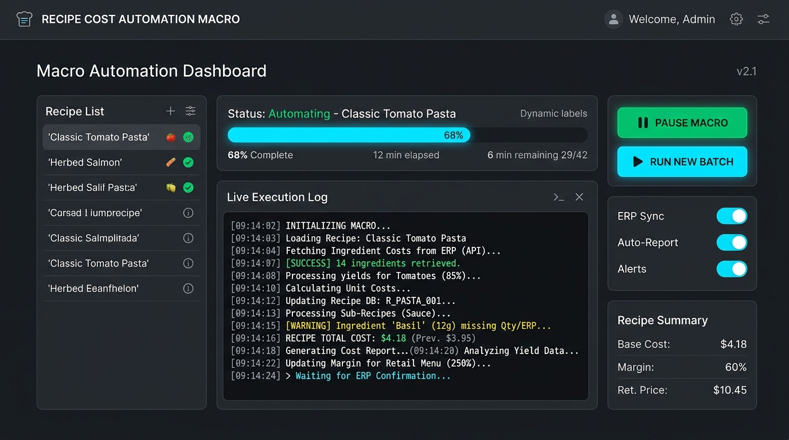

# ⚡ Tiger ERP Reçete Maliyeti Makrosu (v3.1)

[](https://www.python.org/)
[](LICENSE)
[]()
[-brightgreen.svg)]()

> **Kurumsal RPA ve Ürün Ağacı Fiyat Kopyalama Otomasyonu:** Tiger ERP sistemlerindeki ürün reçeteleri, birim maliyetler ve fiyat aktarım süreçlerini sıfır insan hatasıyla saniyede 1 reçete hızında otomatize eden bağımsız masaüstü otomasyon aracı.

---

## 🚀 Hızlı İndirme (Kurulum Gerektirmez - Çalışan En Son Versiyon)

Kodlama veya Python kurulumu yapmadan doğrudan kullanmak için derlenmiş hazır paketi indirebilirsiniz:

| İndirme Bağlantısı | Tür | Boyut | Açıklama |
| :--- | :---: | :---: | :--- |
| 📦 **[Tiger_ERP_Recete_Fiyat_Makrosu_v3.1_Portable.zip](releases/Tiger_ERP_Recete_Fiyat_Makrosu_v3.1_Portable.zip)** | `.zip` | ~33.5 MB | **(Tavsiye Edilen)** Ana makro, Excel şablonu ve kullanım kılavuzu tek pakette. |
| ⚡ **[Recete_Fiyat_Kopyalama_Makro.exe](releases/Recete_Fiyat_Kopyalama_Makro.exe)** | `.exe` | ~33.8 MB | Tekil çalıştırılabilir makro programı. |
| 📊 **[Reçete_Maliyeti_Canlı_Liste_Sablon.xlsx](releases/Reçete_Maliyeti_Canlı_Liste_Sablon.xlsx)** | `.xlsx` | ~5.5 KB | Canlı liste çıktı Excel şablonu. |

---

## 🖥️ Ekran Görüntüsü

<p align="center">
  
</p>

---

## ✨ v3.1 Özellikleri (Çalışan En Son Versiyon)

* **DevExpress LookUpEdit F4 Çözümü:** ERP açılır kutularında kapalıyken Aşağı Ok almayan listelere önce `VK_F4` göndererek tek hamlede sıradaki ürüne iner (ürün başına bekleme 6.5 sn'den 2.5 sn'ye düşürüldü).
* **Canlı Excel Akış Kaydı:** Kopyalanan her satırı anında `Reçete_Maliyeti_Canlı_Liste.xlsx` dosyasına yazar ve diske mühürler (`wb.save`). Olası elektrik kesintisi veya durdurmalarda veri kaybı **sıfırdır**.
* **Çift Mod:** Hem tam otomatik seri tarama (**F6**) hem de tek tek kontrollü adım (**F10**) destekler.
* **Başa Sar (Excel'i Sıfırla):** Yeni bir partiye başlarken Excel'i tek tıkla sıfırlayıp 1. sıraya çeker.
* **Ters Koordinat Kalkanı:** Kullanıcı yanlışlıkla ters koordinat seçerse sesli ve görsel uyarı verir.
* **Saf ctypes (Win32 API):** Ekran ölçeklemesi (%125, %150 DPI) altında fare koordinatlarının kaymasını engelleyen saf Windows çekirdek API mimarisi.

---

## ⌨️ Kısayol Tuşları

| Tuş | Görev | Detay |
| :---: | :--- | :--- |
| **`F6`** | **Seri Otomatik Başlat** | Sırayla tüm reçeteleri açar, fiyatı kopyalar ve Excel'e yazar. |
| **`F7`** | **Duraklat / Durdur** | Otomatik döngüyü anında güvenle durdurur. |
| **`F8`** | **Tablo Fiyat Hücresi Seçimi** | Reçete Maliyeti tablosundaki 1. satır (fiyat hücresi) koordinatını kaydeder. |
| **`F9`** | **Mamül Seçim Kutusu Seçimi** | ERP'deki Mamül Kod LookUpEdit kutusunun koordinatını kaydeder. |
| **`F10`** | **Tek Adım (Manuel Mod)** | Yalnızca 1 reçetenin fiyatını kopyalar ve sıradakine geçer. |
| **`ESC`** | **Acil Durdurma** | Herhangi bir anda acil durdurma yapar. |

---

## 🛠️ Geliştiriciler İçin

### Kaynak Koddan Çalıştırma:
```bash
python -m venv venv
.\venv\Scripts\activate
pip install -r requirements.txt
python recete_fiyat_kopyalama_makro.py
```

### Yeniden EXE Derleme:
Kök dizindeki **`build_exe.cmd`** dosyasına çift tıklayarak tek tıkla standalone EXE üretebilirsiniz.

---

## 📄 Lisans
Bu proje **MIT Lisansı** altında lisanslanmıştır. Detaylar için [LICENSE](LICENSE) dosyasına bakabilirsiniz.
