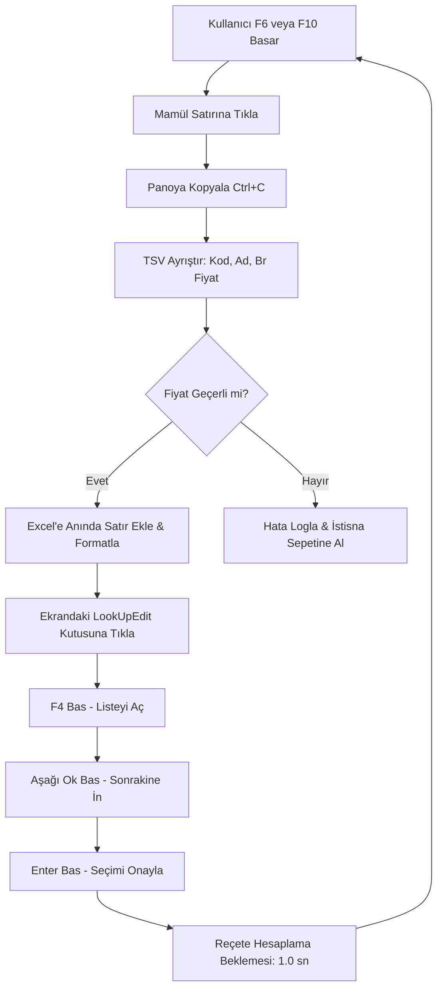

# ⚡ Tiger ERP Reçete Maliyeti & Fiyat Aktarım Makrosu (DevExpress Automation)

<div align="center">


<p align="center">
  <b>Tiger / Logo ERP & DevExpress LookUpEdit Reçete Maliyet Ekranları için Sıfır Kayma Garantili Akıllı Masaüstü Veri Yakalama ve Excel Aktarım Otomasyonu</b>
</p>

</div>

---

## 📌 Proje Genel Bakışı (Nedir ve Ne İşe Yarar?)

ERP (Logo Tiger, Netsis vb.) ve DevExpress altyapısına sahip üretim modüllerinde **"Reçete Maliyeti"** pencereleri yüzlerce yarı mamül ve mamülün hesaplanmış birim fiyatlarını barındırır. Standart ERP arayüzleri bu verileri toplu dışa aktarmaya (export) izin vermediğinde veya LookUpEdit açılır kutularında gezinme zorluğu yaşandığında, personelin yüzlerce ürünü tek tek açıp Excel'e kopyalaması saatler sürer ve insan hatasına yol açar.

Bu uygulama;
1. **Donanım Düzeyinde API Keşfi:** DevExpress `LookUpEdit` kontrollerine `F4` ile açılır liste fırlatarak sıradaki mamüle otomatik geçer.
2. **Akıllı Satır (TSV) Kopyalama:** Mamül tablosundaki ilk satırı ("Kodun Altı") panoya alıp `Mamül Kodu`, `Mamül Adı` ve hesaplanan `Birim Fiyatı` adli hassasiyetle ayrıştırır.
3. **Sıfır Kayma ve Dinamik Senkronizasyon:** ERP'de olmayan reçeteleri veya atlanan kodları tespit eder, fiyatların alt alta kaymasını kesin olarak engeller.
4. **Anında Canlı Excel Kaydı:** Tüm liste bitmeden, çekilen her ürünü o saniye diske (`Reçete_Maliyeti_Canlı_Liste.xlsx`) formatlı olarak yazar.

---

## 🖼️ Ekran Görüntüleri

### Otomasyon Kontrol Paneli & Canlı Terminal
<p align="center">
  
</p>

---

## ✨ Öne Çıkan Özellikler

* 🎯 **Tek Tıkla LookUpEdit F4 Geçişi:** DevExpress kontrollerinde kapalıyken Aşağı Ok almayan listelere önce `VK_F4` göndererek tek hamlede sıradaki ürüne iner.
* 🛡️ **Hücre 38 Sıfır Halüsinasyon / Sıfır Kayma Algoritması:** Eski statik Excel listelerine bağımlı kalmadan, ekrandan gerçekte ne kopyalandıysa onu alır.
* 💾 **Kademeli Anında Kayıt (`wb.save`):** Elektrik kesintisi veya durdurma durumunda veri kaybı 0'dır; çekilen 3 mamül dahi anında Excel'e işlenir.
* 🔄 **Başa Sar (Excel'i Sıfırla) Kalkanı:** Butona basıldığında Excel dosyasını tamamen temizler, sayacı 0'a çekerek sıfırdan 1. sıradan başlamaya hazır eder.
* 📊 **Tek Tıkla Canlı Excel'i Açma:** Uygulama üzerinden Excel dosyasını doğrudan Microsoft Excel'de açıp anlık denetim imkanı.
* 🚀 **Saf CTypes Windows API:** Dış sistem otomasyon kütüphanelerine (pyautogui vb.) ihtiyaç duymadan saf Windows 32/64 API mesajlarıyla ultra hızlı ve hafif çalışma.

---

## ⌨️ Global Kısayol Tuşları

| Kısayol | Fonksiyon | Açıklama |
| :---: | :--- | :--- |
| **`F6`** | **TAM OTOMATİK BAŞLAT** | Belirlenen tekrar sayısı kadar (veya sınırsız) ardışık mamülleri çeker. |
| **`F7`** | **DURAKLAT / DEVAM ET** | İşlemi geçici olarak askıya alır, tekrar basıldığında kaldığı yerden devam eder. |
| **`F8`** | **SATIR KOORDİNATI SEÇ** | Fareyi tablodaki mamül satırına götürüp koordinatı (F8) canlı kaydeder. |
| **`F9`** | **MAMÜL KUTUSU SEÇ** | Fareyi üstteki açılır mamül kutusuna götürüp koordinatı (F9) canlı kaydeder. |
| **`F10`** | **TEK KAYIT AL** | Yalnızca ekrandaki mevcut mamülü kopyalayıp Excel'e ekler. |
| **`ESC`** | **ACİL DURDURMA** | Makroyu derhal güvenli şekilde durdurur. |

---

## 🏗️ Mimari & Çalışma Akışı



---

## 🚀 Kurulum & Çalıştırma

### 1. Yöntem: Bağımsız Taşınabilir EXE (Python Gerektirmez)
1. [Releases](../../releases) sekmesinden `Recete_Fiyat_Kopyalama_Makro.exe` dosyasını indirin.
2. Masaüstünüze koyup çift tıklayarak doğrudan çalıştırın.

### 2. Yöntem: Kaynak Koddan Çalıştırma
```bash
# Repoyu klonlayın
git clone https://github.com/isberke658/Re-ete-Fiyat-Makrosu.git
cd Tiger-ERP-Recete-Fiyat-Makrosu

# Gereksinimleri yükleyin
pip install -r requirements.txt

# Uygulamayı başlatın
python recete_fiyat_kopyalama_makro.py
```

---

## 📦 Tek Tıkla Kendi EXE'nizi Derleyin

Kendi ortamınızda sıfırdan bağımsız `.exe` üretmek için:
```bash
build_exe.cmd
```
veya terminalden:
```bash
pyinstaller --noconfirm Recete_Fiyat_Kopyalama_Makro.spec
```

---

## 📄 Lisans

Bu proje [MIT Lisansı](LICENSE) kapsamında açık kaynak olarak lisanslanmıştır. Ticari ve kişisel projelerde serbestçe kullanılabilir, geliştirilebilir.
